# corne42

Keymap und Firmware für mein Corne (3×6+3, 42 Tasten), gedacht für ein **deutsches (QWERTZ) Host-Layout**.

Das Repo enthält zwei Varianten:

| Ordner | Firmware | Controller | Split |
|---|---|---|---|
| [`vial/`](vial/) | Vial (QMK) | Pro Micro RP2040 | kabelgebunden (TRRS) |
| [`config/`](config/) | ZMK | nice!nano v2 + nice!view | kabellos (BLE) |

Die aktuell gebaute Tastatur läuft mit **Vial auf RP2040**.



## Layout

- **Base:** eigenes Alpha-Layout mit Home-Row-Mods
  - `C` / `T` → Shift / Ctrl (links)
  - `S` / `G` → Ctrl / Shift (rechts)
  - `O` gehalten → Num-Layer
- **Links unten:** Alt (linkes Alt, nicht AltGr); Shift liegt auf den Home-Row-Mods. **Win** liegt auf dem äußeren linken Daumen.
- **Lower** (rechter Daumen): Zahlen und Pfeiltasten
- **Raise** (linker Daumen): Neo2-Symbole („Ebene 3“). `^` und `` ` `` werden als Dead-Key + Leertaste gesendet.
- **Num** (`O` halten): Ziffernblock mit `+ - * / =`

Die Home-Row-Mods nutzen *Chordal Hold*: Ein Mod löst nur aus, wenn die nächste Taste auf der anderen Hand liegt. Tapping-Term 200 ms, Quick-Tap 175 ms.

Das Bild oben erzeugt die CI automatisch aus der ZMK-Keymap. Die Vial-Keymap ist eine Übersetzung davon (ohne Bluetooth-Tasten).

## Vial (Pro Micro RP2040)

### Bauen

Voraussetzung: `git` und `docker`.

```sh
./vial/build.sh          # baut firmware/crkbd_rev1_corne42_rp2040_ce.uf2
./vial/build.sh flash    # baut und flasht anschließend
```

Beim ersten Lauf wird [vial-qmk](https://github.com/vial-kb/vial-qmk) nach `.vial-qmk/` geklont (git-ignored). Gebaut wird im offiziellen `qmk_cli`-Container als `crkbd/rev1` mit `CONVERT_TO=rp2040_ce`.

Eine fertige Firmware liegt in [`firmware/`](firmware/).

### Flashen

1. **BOOT** gedrückt halten und dabei USB einstecken (oder bei gestecktem USB BOOT halten und RESET drücken). Es erscheint das Laufwerk `RPI-RP2`.
2. Die `.uf2` auf das Laufwerk kopieren (oder `./vial/build.sh flash` erledigt das). Der Controller startet danach neu.

Beide Hälften bekommen dieselbe Firmware. Für Keymap-Änderungen reicht es, die **linke** Hälfte neu zu flashen.

### Wichtig

- **USB immer links einstecken**, die Firmware ist auf `MASTER_LEFT` gebaut.
- **TRRS nie bei gestecktem USB ein- oder ausstecken.** Das kann die Controller beschädigen.
- Jeder neue Build setzt die in Vial gespeicherte Belegung auf den Stand von [`vial/keymap.c`](vial/keymap.c) zurück. Änderungen aus der Vial-App also in die `keymap.c` übernehmen.

### OLED

Das linke OLED (128×32) läuft hochkant:

- Oben fliegt eine Rakete durch ein Sternenfeld. Je höher die WPM, desto schneller die Sterne und desto länger die Flamme. Ab ~80 WPM werden die Sterne zu Streifen und die Rakete wackelt. Im Leerlauf schwebt sie.
- Unten stehen der aktive Layer (bei Caps Lock invertiert) und die WPM.

### Dateien

| Datei | Inhalt |
|---|---|
| [`vial/keymap.c`](vial/keymap.c) | Layer, Home-Row-Mods, `^`/`` ` ``-Tasten, OLED-Animation |
| [`vial/config.h`](vial/config.h) | Tapping-Term, Chordal Hold, `MASTER_LEFT`, Layer-Anzahl |
| [`vial/rules.mk`](vial/rules.mk) | Features (Vial, OLED, WPM, RGB) |
| [`vial/vial.json`](vial/vial.json) | Layout-Definition für die Vial-App inkl. Custom-Keycodes |
| [`vial/build.sh`](vial/build.sh) | Build- und Flash-Script |

## ZMK (nice!nano v2)

Die ZMK-Config in [`config/`](config/) wird per GitHub Actions gebaut ([`build.yaml`](build.yaml)). Die Firmware gibt es als Artefakt des Workflow-Runs. Die linke Hälfte hat ZMK Studio aktiviert.
